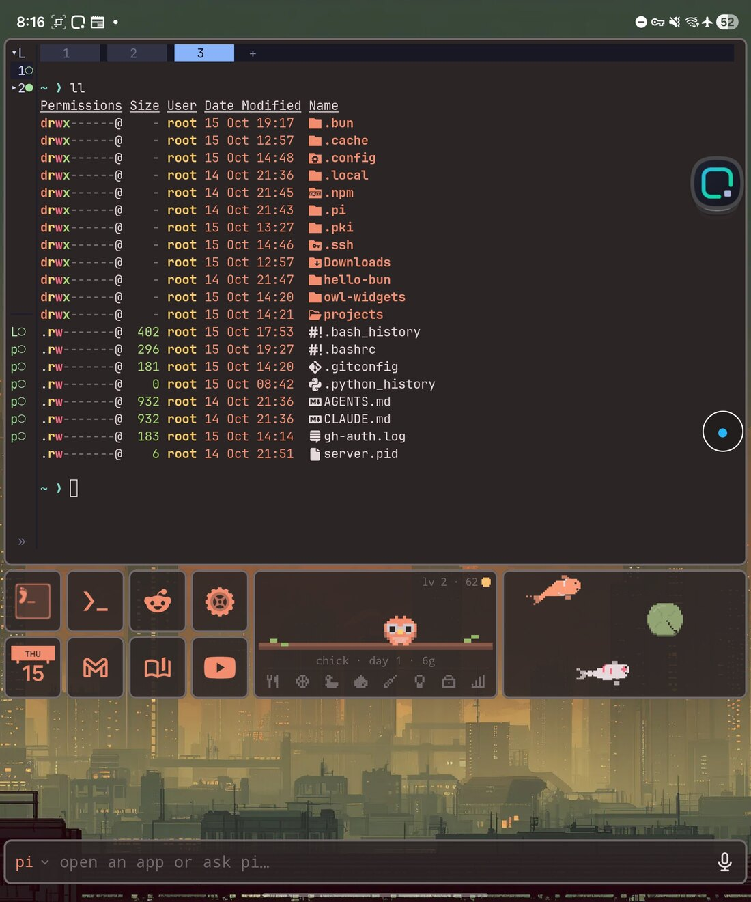
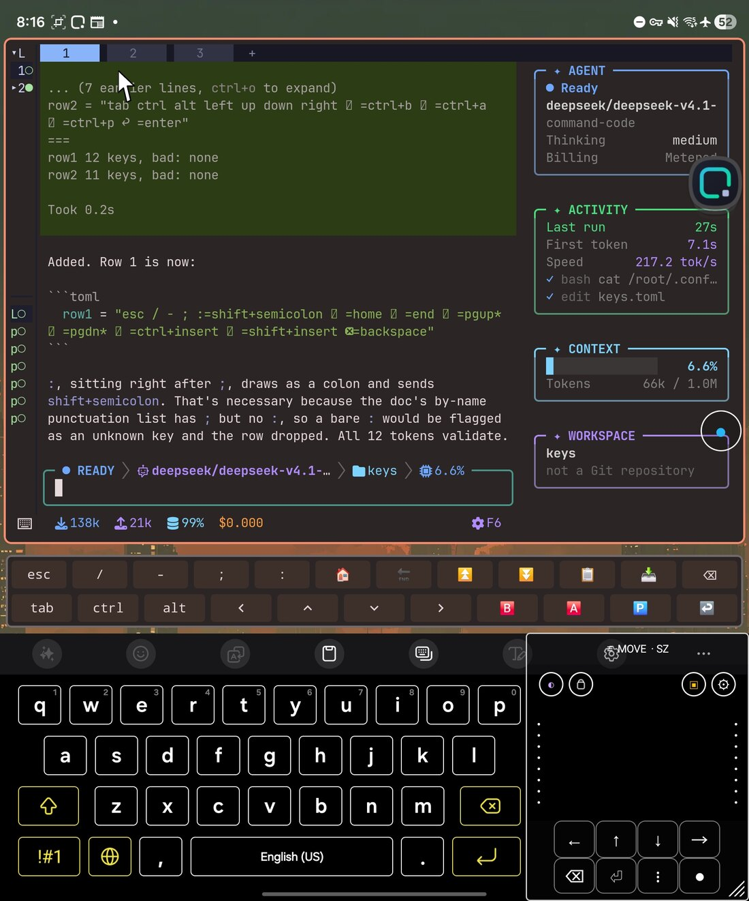
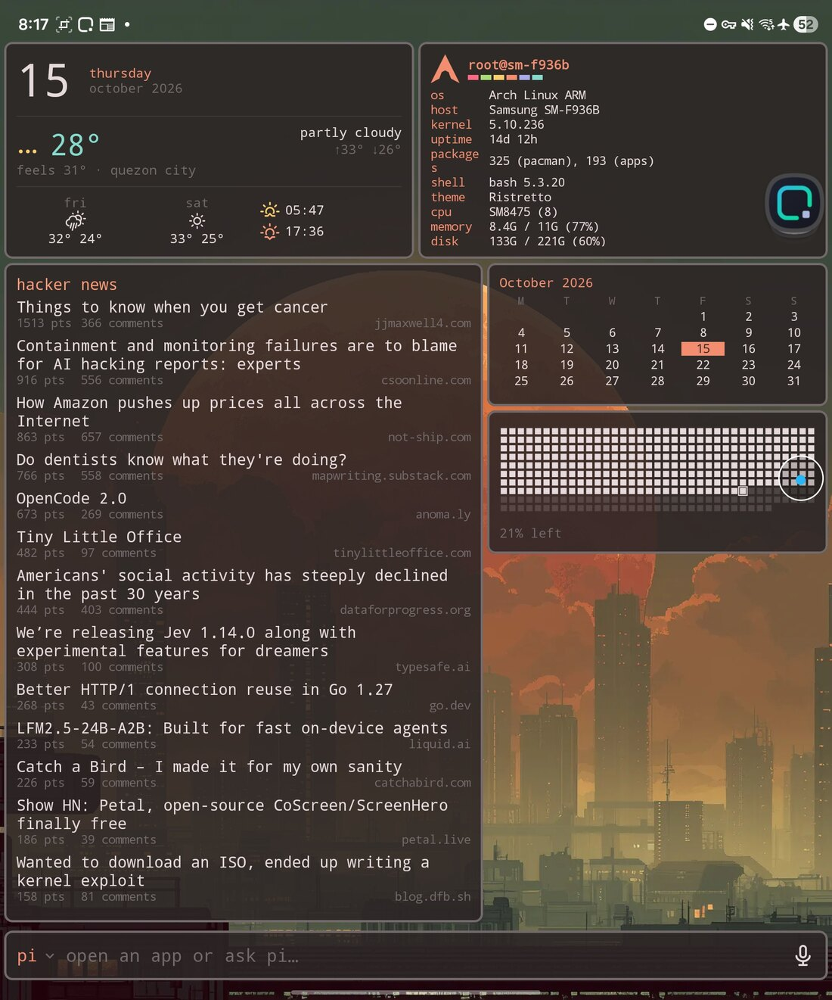
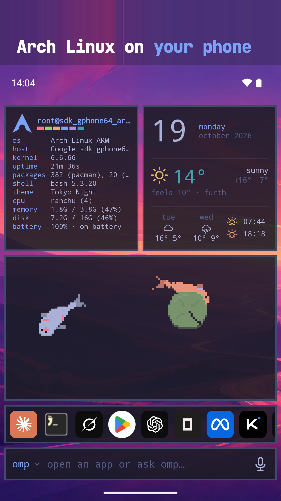

# Omalauncher

> **Fork.** This is [copongcopong/omalauncher](https://github.com/copongcopong/omalauncher), a fork of
> [SimonSchubert/omalauncher](https://github.com/SimonSchubert/omalauncher) developed on `main`. Three
> changes so far, all aimed at a foldable's inner screen:
>
> - The home grid is 12 columns spanning the whole screen instead of two 6-column pages side by
>   side, so a widget tile can be full width.
> - The terminal's ⌨ button sits at the bottom left rather than the bottom right, in both the
>   home screen's terminal tiles and a Linux window's own activity.
> - The extra-keys bar is a config file, `keys.toml`: its rows and keys are edited in the
>   terminal (`~/.config/omalauncher/keys/keys.toml`) and redraw on save, no rebuild. The
>   preset is the fork's own keys — `^b`, `^a` and `^p` on the second row — at
>   `height = 36` and `text = 12`, and the file's own header says how to update it and
>   links the format's docs: [docs/EXTRA-KEYS.md](docs/EXTRA-KEYS.md).
>
> It builds as `dev.omalauncher.fold`, so it installs beside the Play app. Upstream's release
> notes are the [CHANGELOG](CHANGELOG.md); this fork's own changes are under `Unreleased` there.

## The fork, on the Fold

<p>
  
  
  
</p>

Left to right: a terminal tile across the whole inner screen with three tabs; the extra-keys
bar over the soft keyboard while an agent edits `keys.toml`; and widgets laid out full width,
here the date and weather, system info, Hacker News, a calendar and a battery heatmap.

▶ **[The demo, on YouTube](https://youtube.com/shorts/D3fvVJxXpGE)** — a short screen
recording of the fork running on the Fold.

Two things in those screenshots aren't Omalauncher's:

- **The trackpad overlay is a separate app**, [So7o Z Trackpad](https://github.com/jan5o7o/ztrackpad)
  (`app.so7o.ztrackpad`), which draws its own rails, panels and pointer over whatever is on
  screen. In the screenshots that's the letters down the left edge, the round buttons on the
  right, and the `MOVE · SZ` panel with its arrow pad. Omalauncher neither ships it nor
  needs it — the launcher's own touches work without it.
- The status-bar and navigation-bar icons are Android's; the `⌨` button inside a window is
  the fork's, and now sits at the bottom left.

An Android home screen with the look of [Omarchy](https://omarchy.org), and an
optional Arch Linux ARM system next to your phone apps. Omalauncher runs the
system under proot, without root, and is its Wayland compositor: every Linux
window opens as its own Android task, with its own card in Recents.

<a href="https://play.google.com/store/apps/details?id=dev.omalauncher"></a>


<p>
  
  
  
  
</p>

- **Themes**: all 22 Omarchy themes, with their wallpapers, applied to the
  launcher and to the Linux apps, plus the community themes from
  [omarchy.org/themes](https://omarchy.org/themes/), or your own in
  `~/.config/omarchy/themes`
- **Widgets** written in OWL, a small declarative language you can edit on the
  phone, plus a [widget store](https://github.com/SimonSchubert/omarchy-widgets)
- **Linux, optional**: pacman and the AUR, Linux apps in their own windows,
  terminal widgets, a file manager, and opt-in GPU acceleration on Mali GPUs
- **Coding agents**: the bar at the bottom sends a prompt to Claude Code, Codex,
  Copilot, opencode and others, which open in a terminal
- No account, no ads, no tracking

Needs an arm64 phone with Android 10 or newer. Without Linux, the launcher still
has the themes, wallpapers, Android apps and the widgets that don't run commands.

## Using it

The bar: the one input at the bottom of the home screen opens apps and asks
coding agents. Focusing it opens the list of Linux and Android apps; typing
narrows the list, and Enter opens the highlighted app or sends the text to the
agent. Short queries that name an app open it, sentences go to the agent; Tab
and the arrow keys move the highlight. Tap the agent's name to pick another
installed one; the choice is saved in `~/.config/omalauncher/agent`. Hold the mic to talk and release to send, or tap it to dictate
into the field. Speech is recognized by Android (on the device when the phone
supports it), so only text reaches Linux.

Touch input in Linux windows: tap is a left click, long press is a right
click, drag scrolls; apps with touch support (foot, GTK) get real touch.
Focusing a terminal raises the soft keyboard with the extra-keys bar above it —
ctrl, alt and shift and whatever else you put in `keys.toml`; see
[docs/EXTRA-KEYS.md](docs/EXTRA-KEYS.md).
Hardware keyboard shortcuts: Super+Enter (terminal), Super+Space or
Super+A (the bar), Super+1..9 (home pages) on the home screen; Super+Enter
and Super+W (close) in Linux windows.

## Building

```sh
./scripts/fetch-proot.sh          # Termux's proot -> app/src/main/jniLibs (needs bsdtar)
./gradlew :app:installDebug
# optional: skip the 830 MB download on the device
adb push ArchLinuxARM-aarch64-latest.tar.gz /sdcard/Android/data/dev.omalauncher/files/
```

Tests: `./gradlew :owl:test :app:testDebugUnitTest`. `./gradlew :owl:owlJar`
builds `owl/build/cli/owl.jar`, the checker the widget store's CI runs.

On a Linux box with an Android SDK and a JDK 17 or newer, the same two commands build the fork:
point `ANDROID_HOME` (or `local.properties`) at the SDK, install the NDK that
`scripts/fetch-proot.sh` pins, and have `bsdtar` on `PATH` (Debian/Ubuntu: `libarchive-tools`).
The `main` branch is what gets built.

In debug builds you can launch guest commands with
`adb shell am start -n dev.omalauncher/.MainActivity --es exec foot`.

- [docs/ARCHITECTURE.md](docs/ARCHITECTURE.md): the compositor, rendering, GPU
  acceleration, and how updates reach existing installs
- [docs/EXTRA-KEYS.md](docs/EXTRA-KEYS.md): the terminal's extra-keys bar and the
  `keys.toml` that its rows, keys and height come from
- [docs/RELEASING.md](docs/RELEASING.md): Play releases and store assets
- [app/src/main/assets/widgets/README.md](app/src/main/assets/widgets/README.md):
  the widget language

## Layout

- `app/`: the Android app (Kotlin, Jetpack Compose, and the JNI bridge in `src/main/cpp`)
- `owl/`: the widget language and the `owl` command line, plain Kotlin
- `art/`: SVG masters for the app, agent and store icons
- `store/`: Play listing sources (screenshot frames, privacy policy)
- `fastlane/`: the Play listing and the upload lanes
- `scripts/`: fetching proot and theme colors, rendering icons, screenshots and widget previews

## License

MIT, see [LICENSE](LICENSE), for Omalauncher's own code and artwork. The
coding agents' logos, the symbol font and Omarchy's theme colors are not
covered; [THIRD_PARTY.md](THIRD_PARTY.md) lists them with their sources and
licenses. The app also ships proot, talloc and libandroid-shmem (GPL-2.0,
LGPL-3.0 and BSD-3-Clause, prebuilt by Termux), listed in the app under
settings › licenses.

Omalauncher is an independent project and is not affiliated with or endorsed
by Omarchy, Arch Linux, or the makers of the coding agents it installs.
